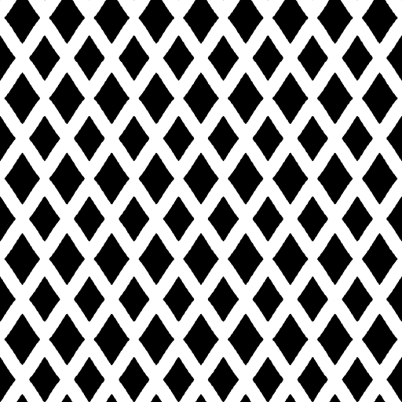
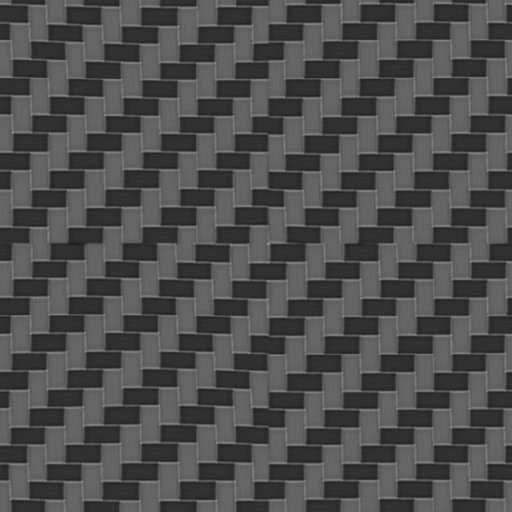
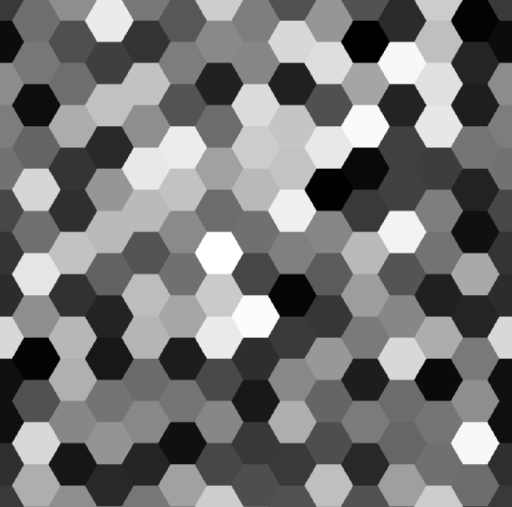

<!-- SPDX-License-Identifier: AGPL-3.0-only -->
# Texturizer for FreeCAD

> Not affiliated with or endorsed by the FreeCAD project, the FreeCAD Project
> Association (FPA) or CNC Kitchen. FreeCAD is the FPA's trademark. Get FreeCAD
> itself from [freecad.org](https://freecad.org).

- [What it is](#what-it-is)
- [What you need](#what-you-need)
- [Install](#install)
- [First steps](#first-steps)
- [Screenshots](#screenshots)
- [What you see in FreeCAD](#what-you-see-in-freecad)
- [What an agent can do with it](#what-an-agent-can-do-with-it)
- [Troubleshooting](#troubleshooting)
- [Uninstall](#uninstall), [Privacy](#privacy)
- [Texture licences](#texture-licences), [Licence](#licence), [Credits](#credits)

How it plugs into Agent Link, with a diagram: [docs/workflow/](https://github.com/jamesK1000011/Texturizer-FreeCAD/blob/main/docs/workflow/README.md).

## What it is

Texturizer puts a surface texture on a part you designed in FreeCAD: knurling
on a grip, wood grain on a box, a weave on a lid. It is **BumpMesh by Stefan
Hermann (CNC Kitchen)**, ported into FreeCAD. BumpMesh is the free web tool at
[github.com/CNCKitchen/stlTexturizer](https://github.com/CNCKitchen/stlTexturizer)
that textures STL files for 3D printing. Texturizer runs the same engine, with
the same settings and the same texture library, directly on your FreeCAD
part. You get a textured mesh beside your part, ready to print as STL or 3MF.
Your part itself is never changed.

A mesh is a surface made of many small triangles. 3D printers and slicers use meshes.
With [Agent Link for FreeCAD](https://github.com/jamesK1000011/AgentLink-FreeCAD), an AI agent can pick a texture, mask faces and make the mesh for you, in the background.

### Who it is for

- Anyone who 3D prints FreeCAD parts and wants a texture on them without
  leaving FreeCAD for another tool.
- People who already know BumpMesh: every control is where BumpMesh has it.
- People who let an AI agent work in FreeCAD through
  [Agent Link for FreeCAD](https://github.com/jamesK1000011/AgentLink-FreeCAD).
  The agent can pick a texture, mask faces and make the mesh for you.

You do not need to know Python, mesh editing or BumpMesh. You do not need an
agent.

## What you need

- FreeCAD 1.0 or newer (1.1 recommended).
- numpy, which comes with FreeCAD.
- Optional: [Agent Link for FreeCAD](https://github.com/jamesK1000011/AgentLink-FreeCAD) and an MCP client (for example Claude Desktop), so that an agent can use Texturizer.

## Install

Pick one.

### With Agent Link's Claude Desktop extension (easiest)

1. Install [Agent Link for FreeCAD](https://github.com/jamesK1000011/AgentLink-FreeCAD#install) with its Claude Desktop extension.
2. Start a new chat.

The extension installs Texturizer for you into FreeCAD's `Mod` folder as `Texturizer`, and keeps it up to date.

### With the Addon Manager (custom repository)

1. Open **Edit ▸ Preferences ▸ Addon Manager**.
2. Under **Custom repositories**, add
   `https://github.com/jamesK1000011/Texturizer-FreeCAD` with branch `main`.
3. Open **Tools ▸ Addon manager**, find **Texturizer**, and click **Install**.
4. Restart FreeCAD.

### By hand

Put this folder in FreeCAD's `Mod` folder as `Texturizer` and restart FreeCAD.
To find the folder, type `FreeCAD.getUserAppDataDir()` in FreeCAD's Python console (the `Mod` folder is inside it).

## First steps

**With an agent** (Agent Link installed). Select a part in FreeCAD, start a new chat, and try these prompts:

1. "Put a knurled grip on the round faces of this part, 0.5 mm deep."

   The agent starts a texture draft. In the Texturizer sidebar you see the texture, depth and mask change as it works.

2. "Show me a preview."

   The agent builds the real textured mesh with BumpMesh's engine and shows you a picture.

3. "Add it to the document and export a 3MF."

   A Textured mesh is put beside your part, and the 3MF file is written. Your part is not changed.

**Without an agent.** Pick **Texturizer** from the workbench list. The sidebar opens with the selected part.
Pick a texture in the Displacement Map section, then use **Add to document** or **Export 3MF**.

## Screenshots

<!-- screenshots: no screenshots of the add-on are in the repository yet. Take these and add them under docs/images/:
- a FreeCAD part with a knurled grip, the Texturizer sidebar open on the right
- the workbench list with Texturizer picked
- the Texturizer sidebar, Displacement Map and Masking sections open
- the Texture Gallery with the Grip category open
- Quick look on a part, then the same part with 3D Preview on
- the Texture tab in the Agent Link panel
-->

No screenshots of the add-on yet. Three texture maps from the library (BumpMesh's own, by CNC Kitchen):

| Knurling | Carbon Fiber | Hexagons |
|---|---|---|
|  |  |  |

## What you see in FreeCAD

**The Texturizer workbench.** Pick **Texturizer** from the workbench list.
Entering it opens the sidebar with the part you selected loaded.

<!-- screenshot: the workbench list with Texturizer picked -->

**BumpMesh's sidebar**, docked on the right. It has BumpMesh's sections, in
BumpMesh's order, with its labels, ranges and defaults:

- **Use Selected Part** (the selected solid; else this document's last
  textured part, else the one solid shown; import an STL with File ▸ Import
  first), **Place on Face** and **Rotate**.
- **Displacement Map**: the layer strip (up to 4 layers), favourites, the
  Texture Gallery and Upload custom map.
- **Projection**, **Texture Depth** and **Transform**: how the texture wraps,
  how deep it goes, and its size and angle.
- **Masking**: keep faces plain or texture only some, by angle or by picking
  FreeCAD faces.
- **Advanced / Beta Features**, including **Bake Textures**. A bake makes the
  textured mesh your new part, so you can add another texture on top. With
  **Mask just-baked faces** on (the default), the faces you just textured
  stay as they are on the next layer.
- **Export**: Suggest values, Resolution, Output Triangles, **Add to
  document** / **Update**, and **Export 3MF**. For an STL, export the
  Textured object with FreeCAD's File ▸ Export.

<!-- screenshot: the Texturizer sidebar, Displacement Map and Masking sections open -->

**The Texture Gallery**, a dock beside the sidebar. Search, categories,
favourites, your own heightmaps, and a credit badge on each tile (HP, CC0,
CNC Kitchen, Yours).

<!-- screenshot: the Texture Gallery with the Grip category open -->

**The toolbars.**

- **Texturizer** is BumpMesh's header row: Reset to Defaults, Export
  BumpMesh Project…, Import BumpMesh Project…, Texture Gallery, Export 3MF.
  The texture draft is saved with the FreeCAD document, and FreeCAD's own
  Edit ▸ Undo / Redo undo texture edits; the BumpMesh project files
  (`.bumpmesh`) are for sharing with the BumpMesh web app.
- **View** has Section View (FreeCAD's clipping plane). For wireframe and
  perspective, use FreeCAD's own Draw Style and camera commands.
- **Check** has Prepare for Texture and Check Textured Mesh.

**Quick look and the preview.** While you change settings, **Quick look**
shows the texture on the part right away (a shader, no mesh is built). Turn on
**3D Preview** for the real thing: BumpMesh's engine builds the displaced
mesh, so what you see is what prints (Draft 500 k triangles, Fine 1.5 M).
Where the shader can't run, it falls back to the engine preview.

<!-- screenshot: Quick look on a part, then the same part with 3D Preview on -->

**Textured objects.** Add to Document puts a Textured mesh beside your part.
It remembers the settings it was made with. When you change the part, it is
marked out of date; click **Update** to texture it again. It never reruns on
its own.

Panels take their colours from your FreeCAD theme. Texturizer never sets a
stylesheet on FreeCAD itself.

## What an agent can do with it

When Agent Link for FreeCAD is installed, an agent gets these tools. They
work on the same draft the sidebar shows, so you watch the sliders move as
the agent works. The list is generated from `texturizer/data/tools.json` by
`tools/gen_readme_tools.py`.

<!-- tools:begin (generated by tools/gen_readme_tools.py) -->
| Tool | Group | What it does |
|---|---|---|
| `texture_list` | texture | List the texture library that Texturizer ships. |
| `texture_settings` | texture | Read BumpMesh's settings as the engine takes them, and the cost of a run on a body. |
| `texture_draft` | texture | Start or read the texture draft. |
| `texture_set` | texture | Change the draft. |
| `texture_mask` | texture | Set where the texture of one layer goes; texture_draft first. |
| `texture_layer` | texture | Edit the layer strip of the draft: 1 to 4 layers, and layer 0 is the bottom. |
| `texture_preview` | texture | Build the preview of the draft with BumpMesh's engine, and wait for it. |
| `texture_apply` | texture | Texture a part and put the result in the document. |
| `texture_export` | texture | Write a file. |
| `texture_prepare` | texture | Prepare a body for texturing outside FreeCAD. |
| `texture_check` | texture | Measure a textured mesh against the body it was made from, face by face. |
<!-- tools:end -->

The texturing in every one of them is BumpMesh's engine, ported to Python.

### Alone or with Agent Link

| | Alone | With Agent Link |
|---|---|---|
| Workbench, sidebar, Texture Gallery, toolbars | Yes | Yes |
| Quick look, 3D Preview, Add to Document, Update, Bake | Yes | Yes |
| Export STL / 3MF, Save / Load Project | Yes | Yes |
| Sidebar clicks | Run by Texturizer itself | Run through Agent Link, shown and logged in its Activity |
| Texture tab in Agent Link's panel (last results, open the sidebar) | No | Yes |
| Agent tools above | No | Yes |

Texturizer never needs Agent Link. Only `texturizer/agentlink_families.py`
and the `fam_*` module it loads import Agent Link, and only Agent Link loads
them. Agent Link carries no cost for Texturizer when Texturizer is not
installed.

## Troubleshooting

**No part is loaded in the sidebar.**
Select a solid and click **Use Selected Part**. To texture an STL, import it first with File ▸ Import.

**The Textured object is out of date.**
You changed the part. Click **Update** to texture it again. It never runs again on its own.

**The preview is slow.**
Use **Quick look** while you change settings: it builds no mesh.
Turn on **3D Preview** only to see the real mesh (Draft is 500 k triangles, Fine is 1.5 M).

**The agent does not have the texture tools.**
- Most clients read the tool list when a chat starts. After an install or an update, **start a new chat**.
- In Agent Link, `session_state` shows an add-on that did not load under `leftOut`, with the error.
  Update it (`agentlink_update` with the Claude extension, or the Addon Manager), then restart FreeCAD.

**A texture from BumpMesh is missing.**
BumpMesh's Filter Forge textures are left out: their licence does not allow them to be shipped here.

**The window or FreeCAD is stuck.**
See the troubleshooting of [Agent Link for FreeCAD](https://github.com/jamesK1000011/AgentLink-FreeCAD#troubleshooting) (`job_status`, `dialog_answer`, `app_force_restart`).

## Uninstall

- **Addon Manager**: Tools ▸ Addon manager ▸ Texturizer ▸ Uninstall, then
  restart FreeCAD.
- **By hand, or installed through Agent Link**: delete the `Texturizer`
  folder from FreeCAD's `Mod` folder, and restart FreeCAD.
- Exports and `.bumpmesh` projects are yours to keep: they go where you
  save them (or to `~/Texturizer` when an agent gives no folder). Export a
  Textured object as STL or 3MF first if you want it without Texturizer.
- The preview keeps a few refined copies of recently previewed parts in
  `Texturizer/cache` inside FreeCAD's user data folder (the newest 8, so a
  part opens fast after a restart); delete that folder to clear them.

## Privacy

Texturizer has no telemetry and makes no network connection: the texture
library ships with it, and images you add are read from your own disk. Your
part, its textures and exports stay on your computer (the preview's cache
of refined parts too, in FreeCAD's user data folder). With Agent Link, what
the agent reads goes to the AI provider your MCP client uses, under that
provider's terms.

## For developers

```
AGENTLINK_HOME=$(mktemp -d) python3 -m unittest discover -s tests
python3 tools/gen_readme_tools.py           # refresh the tool list above
python3 tools/gen_readme_tools.py --check   # exit 1 if it is out of date
```

`texturizer.engine` is the ported engine and imports neither FreeCAD nor
Agent Link. On the reference cases in `tests/reference/` its output is
bit-identical to BumpMesh's own engine (`tests/test_engine_parity.py`).

```python
from texturizer import engine
engine.library.list()                        # id, name, category, credit, licence, defaults
r = engine.texture(positions, {"texture": "Knurling", "scaleU": 5, "textureHeight": 0.5,
                               "refineLength": 0.4}, mask=engine.by_normal(positions, (0, 0, -1), 10))
engine.export(positions, settings, mask, "part.3mf")
```

## Texture licences

The texture library is BumpMesh's, as `texturizer/textures/LICENSES.md` lists
it, file by file:

- **Hero Patterns** by Steve Schoger, CC BY 4.0. Exports that use one carry
  its credit line.
- **ambientCG** and **Poly Haven** maps, CC0 1.0 (public domain).
- **BumpMesh's own** textures by CNC Kitchen, AGPL-3.0.

BumpMesh's Filter Forge textures are left out: their licence does not allow
them to be shipped here. The licence texts are in `LICENSES/`.

## Licence

Code: AGPL-3.0-only (`LICENSE`), to match BumpMesh. `texturizer/meshdist.py`
is a copy of Agent Link's and keeps its LGPL-2.1-or-later. Data files
(`texturizer/data/*.json`): CC BY 4.0 (`LICENSE-DATA`). Textures: as above.
Each file's licence is stated in its header or in `REUSE.toml`; the texts are
in `LICENSES/`.

## Credits

- The texturing engine, the settings sidebar's layout, the texture library
  and the `.bumpmesh` format are **BumpMesh by Stefan Hermann (CNC Kitchen)**,
  [github.com/CNCKitchen/stlTexturizer](https://github.com/CNCKitchen/stlTexturizer),
  AGPL-3.0. They are ported to Python file by file; each module names the
  BumpMesh file it ports. Laying the workbench out as BumpMesh is part of
  that credit.
- Textures based on Hero Patterns by Steve Schoger (CC BY 4.0); maps from
  ambientCG and Poly Haven (CC0).
- Icons are new drawings in FreeCAD's icon style. Their designs follow glyphs
  from [Tabler Icons](https://tabler.io/icons) (MIT) and
  [Pictogrammers Material Design Icons](https://pictogrammers.com)
  (Apache-2.0). See `texturizer/icons/CREDITS.md`. FreeCAD's own icons are
  used by name from FreeCAD.
