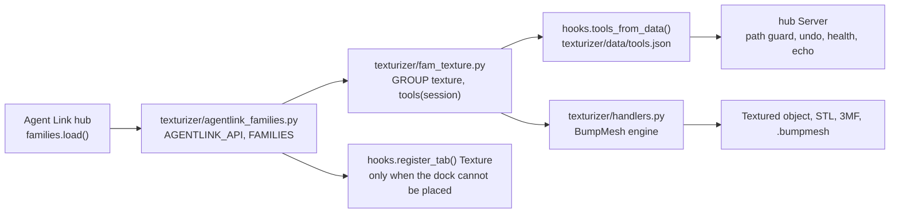

# How Texturizer plugs into Agent Link
<!-- SPDX-License-Identifier: AGPL-3.0-only -->

Texturizer is **BumpMesh by Stefan Hermann (CNC Kitchen)**, ported into FreeCAD. BumpMesh is the free web tool at [github.com/CNCKitchen/stlTexturizer](https://github.com/CNCKitchen/stlTexturizer). Texturizer runs the same engine, with the same settings and texture library. Its licence is AGPL-3.0-only.
This page tells how its tools reach the agent through Agent Link for FreeCAD (the hub). The hub's own flow is in [the hub's workflow pages](https://github.com/jamesK1000011/AgentLink-FreeCAD/blob/main/docs/workflow/README.md).

## How the hub finds it

- The hub loads any package on FreeCAD's path that holds `agentlink_families.py`. Here that is `texturizer/agentlink_families.py`. The hub never names this add-on.
- `AGENTLINK_API = ">=1,<2"`. A hub with another API leaves Texturizer's tools out and says why.
- Only `texturizer/agentlink_families.py` and `texturizer/fam_texture.py` import Agent Link. Without Agent Link, they are never imported, and Texturizer works alone.
- `CREDIT` and `LICENSE` (`AGPL-3.0-only`) show where its tools load.

## Its tools

- One family: `texturizer/fam_texture.py`, group `texture`. It is not in the lean list. The agent finds a tool with `tool_find` and calls it by name.
- The tools are data: `texturizer/data/tools.json`, in the hub's tool data format.
- `fam_texture.tools(session)` lends the hub's `ToolError` and face queries to the handlers (`handlers.lend()`). It binds each entry to its handler in `texturizer/handlers.py` with `hooks.tools_from_data()`.
- The tools: `texture_list`, `texture_settings`, `texture_draft`, `texture_set`, `texture_mask`, `texture_layer`, `texture_preview`, `texture_apply`, `texture_export`, `texture_prepare`, `texture_check`.
- The echo tables (`WORKBENCHES`, `COMMANDS`, `AREAS`, `SHOWN`, `NO_BUTTON`, `OPENS`, `PHRASES`) show each call on the Texturizer workbench and its buttons.

## The panel

- Texturizer's sidebar is its own dock beside Model and Tasks. Under Agent Link, a click in the sidebar runs through the hub, so the Activity tab shows it.
- Only when the hub cannot place the dock (`layout.hosted_tabs()`), Texturizer registers a **Texture** tab in the Agent Link panel (`hooks.register_tab()`). That tab shows only while the Texturizer workbench is in front. It carries its own credit line (`own_credit=True`).

## What it reads and writes

- **Reads.** The FreeCAD body and its faces. The texture library in `texturizer/textures`. A `.bumpmesh` project that the agent names (`texture_draft { project }`).
- **Writes, in the document.** `texture_apply` is the only changing tool. It makes the Textured object in the document. The part itself is never changed.
- **Writes, in files.** `texture_export` (STL, 3MF or a `.bumpmesh` project) and `texture_prepare` (an STL and its `<name>-mask.json`) have `writes: true`. The hub checks their `path` as a write. `texture_apply { export }` is a write field for every tool in the hub.
- **Heavy tools.** `texture_preview`, `texture_apply`, `texture_export` and `texture_prepare` have `heavy: true`. They go to the hub's heavy queue. A long read can run as a job.

## Approvals

Texturizer's tools ask for no approval. They run no code from outside and send nothing to a printer.

## Diagram

